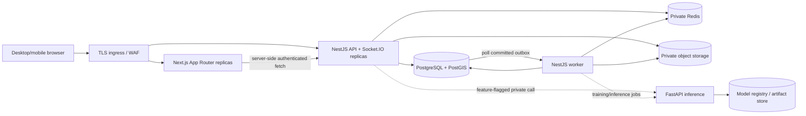
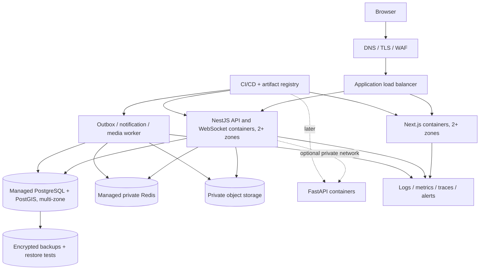

# CropCircle — Technical Implementation Plan

| Field | Value |
|---|---|
| Document | TIP-001 |
| Version | 0.1, proposed design baseline |
| Date | 2026-11-21 |
| Status | Architecture and delivery plan; implementation has not started |
| Governing requirements | [SRS-001](SRS.md) |

## 1. Engineering approach and MVP boundary

Implement the first release as a **NestJS modular monolith** with one PostgreSQL/PostGIS database. Next.js is the web application; NestJS is the only public business API and Socket.IO gateway. Redis handles low-latency fanout, bounded caching, and optional background work. A separate NestJS worker publishes committed outbox events and processes notifications/media tasks. Python FastAPI is a private model-serving boundary for a later validated release; no MVP user journey depends on an ML service being healthy. This partition keeps one transaction boundary for listing, request, capacity, and audit changes.

MVP completes SRS workflows A–J through explicit rules and human choices. It does not claim that a score is learned by AI. Once sufficient consented outcomes exist, a feature-flagged FastAPI reranker can replace ordering within the already eligible set. Issue similarity follows the same progression from crop/tag/region search to optional semantic retrieval. Product decisions in [SRS §14](SRS.md#14-decision-register-and-dependencies) block the listed milestones; engineers should not encode defaults for food safety, privacy, payments, or ownership without the appropriate decision.

## 2. Logical architecture and ownership



| Component | Responsibility | Deployment and trust boundary |
|---|---|---|
| Next.js App Router | Accessible pages, forms, lists, maps, interactive timelines, server-rendered initial data and client-side Socket.IO updates. | Public web container. Server Components call NestJS with the authenticated user context; Client Components handle browser APIs and interactions. Do not duplicate business rules in Next.js. [Next.js component guidance](https://nextjs.org/docs/app/getting-started/server-and-client-components). |
| NestJS REST | Auth/session mapping, role and ownership policy, validation, listings, eligibility, requests, pickup, issue reports, groups, verification, moderation, OpenAPI. | Public only through TLS ingress. Single write authority and transactional boundary. |
| NestJS Socket.IO gateway | Authenticated room membership, safe scoped invalidations, versioned event envelope, heartbeat/reconnect guidance. | Public through `/realtime`; horizontally replicated via Redis adapter. |
| PostgreSQL/PostGIS | Canonical records, constraints, private/coarse geometry, audit, transactional outbox, relational search. | Private managed database; migrations are reviewed and reversible where feasible. |
| Redis | Socket fanout, short-lived cache, rate limiting, queue coordination. | Private and authenticated. Loss of Redis must not lose transfers or durable notifications. [Socket.IO adapter security](https://socket.io/docs/v4/redis-adapter/). |
| NestJS worker | Polls outbox, emits events, creates notifications, scans/processes media, expires resources and recomputes projections. | Private stateless worker; idempotent handlers. BullMQ may schedule noncritical jobs ([NestJS queues](https://docs.nestjs.com/techniques/queues)). |
| FastAPI | Later inference endpoints for recipient reranking and issue similarity, with typed contracts and model versioning. | Private service reachable only by NestJS/worker, disabled by feature flag in MVP. |
| Object storage | Listing/report photos and verification evidence. | Private bucket, short-lived signed URLs, scan state, retention policy. |
| Identity provider | Registration/login, session or OIDC claims, password/MFA lifecycle. | Provider decision D-02; NestJS still enforces all application authorization. |
| Map/geocoder | Base tiles, geocoding, optional road travel time. | Provider decision D-13; no sensitive coordinates sent to a third party without privacy review. |

**Request path:** A reverse proxy routes `/api/v1` and `/realtime` to NestJS and other application routes to Next.js under one origin where feasible. Browser requests use secure, HttpOnly session cookies or an approved token scheme; NestJS validates every call. Server-side Next.js fetches forward only the needed user assertion. Public assets are cached; personalized pages and API responses have scope-aware/no-shared-cache rules. OIDC, cookie, CSRF, and WebSocket handshake details are settled in M1 after D-02.

### 2.1 Proposed repository layout

```text
apps/
  web/                 Next.js App Router, UI components, design system
  api/                 NestJS REST, domain modules, Socket.IO gateway
  worker/              NestJS outbox and background processors
  inference/           FastAPI model contracts and serving (Later)
packages/
  contracts/           generated OpenAPI client and event schemas
  config/              shared lint/type/build configuration
infra/                 infrastructure as code, environments, dashboards
docs/                  SRS, implementation plan, ADRs, runbooks
```

This is a suggested layout, not created application code. Keep API DTOs and event schemas versioned and generated into the web client. Python has its own lockfile and tests. CI enforces migrations and contract compatibility.

### 2.2 NestJS module boundaries

| Module | Owns | Dependencies and events |
|---|---|---|
| Identity/AuthZ | User projection, role and membership guards, admin MFA enforcement | Identity provider; no other module bypasses guards. |
| Organizations/Verification | Organization/sites, members, capabilities, availability, verification cases | GeoSearch and Recommendations read approved projections; emits availability/verification changes. |
| Listings | Listing lifecycle, quantity and site ownership | Reads crop taxonomy/sites; emits listing changes. |
| GeoSearch/Eligibility | PostGIS radius, hard recipient gates and bounded map queries | Reads listing, sites, capabilities, windows; never writes transfers. |
| Recommendations | Deterministic score, method/version/reasons, later FastAPI adapter | Accepts eligible site IDs only; never reintroduces excluded sites. |
| Transfers/Pickup | Request lifecycle, capacity reservation, schedule, handoff/receipt/dispute | Owns transaction across listing/request/capacity and emits transfer events. |
| Issues/Taxonomy | Issue reports, tags, consent and visibility | Search and groups use centralized visibility policy. |
| Connections/Messaging | Opt-in contact, direct thread and message permission | Reads issue/professional visibility and blocks. |
| Groups | Invitations, membership, posts, explicit report shares | Central group access policy; events to group/user rooms. |
| Admin/Moderation/Audit | Review decisions, suspensions, moderation, safe audit | Every high-impact write has actor/reason and outbox record. |
| Media/Notifications/Outbox | Upload intents/scan, durable notifications, event delivery | Storage/Redis/worker; no public direct object access. |

## 3. Key transaction and data flows

### 3.1 Create and publish a listing (A)

1. Web validates fields for feedback; NestJS repeats authoritative validation and checks active farm membership and site ownership.
2. Normalize mass into canonical kilograms while retaining the user-entered value/unit; validate time zone, availability, crop, offer mode, condition and optional sale terms.
3. One DB transaction inserts the listing (`open`, version 1), audit event, and `listing.created` outbox row. A media asset is visible only after scan approval.
4. Worker publishes through the private Socket.IO Redis emitter; gateway replicas fan out to the authorized farm room and, where safe under D-07, a coalesced map-region invalidation. The UI displays the committed listing and version.

### 3.2 Discover and rank (B–C)

1. GeoSearch reads the listing's **private** exact point from PostgreSQL. A bounded PostGIS query returns approved sites whose exact point is within their allowed service radius and the user's search bound.
2. Eligibility filters mode, crop, full-listing mass/max batch, free capacity (`declared_capacity_kg - reserved_kg`) in a selected finite intake window, freshness, pickup/handling/storage and overlap with farmer availability and listing active period. Unknown or stale capacity is not labeled "can accept" until D-03 defines confirmation behavior.
3. Recommendations scores the eligible set with documented distance/window/capacity features, deterministic tie-break (`site_id`), `method=rules`, and a score version. The user sees reasons and last-updated time. No automatic request is sent.
4. Later, feature flag `ml_recipient_rerank` may call FastAPI with only eligible features. NestJS enforces a short timeout, validates the response contains exactly permitted site IDs, records model version, and falls back to the rule score on error or low confidence.

**Spatial query contract:** `ST_DWithin(listing_site.exact_geog, recipient_site.exact_geog, recipient_capabilities.service_radius_m)` uses `geography` distances in meters and a GiST index. The service-radius value varies by recipient, so query plans must be profiled; a maximum search radius and candidate prefilter keep scans bounded. `ST_DWithin` uses an available spatial index in its bounding-box phase ([PostGIS documentation](https://postgis.net/docs/ST_DWithin.html)). Road travel time is a later, separately licensed routing feature.

### 3.3 Request, accept, and pickup (D–F)

```mermaid
sequenceDiagram
    actor Farmer
    participant Web as Next.js
    participant API as NestJS
    participant DB as PostgreSQL/PostGIS
    participant Worker as Outbox worker
    participant Emitter as Private Redis emitter
    participant Socket as Socket.IO
    actor Recipient
    Farmer->>Web: Select recipient, intake window and review full-batch terms
    Web->>API: POST transfer request + idempotency key
    API->>DB: Recheck listing/eligibility; insert pending request + outbox
    DB-->>API: Commit request/version
    API-->>Web: 201 pending request
    Worker->>DB: Read committed outbox
    Worker->>Emitter: Publish request.created after commit
    Emitter->>Socket: Fan out to authorized party rooms
    Socket-->>Recipient: Request invalidation
    Recipient->>API: Accept with expected version + idempotency key
    API->>DB: Lock listing/intake window; recheck; reserve; insert outbox
    DB-->>API: Commit request/listing/window versions
    API-->>Recipient: 200 accepted
    Worker->>Emitter: Publish request, listing, availability and map changes
    Emitter->>Socket: Fan out scoped invalidations
    Socket-->>Farmer: Refetch authoritative detail
```

The one-active-request MVP rule and full-listing quantity equality are enforced at request creation. A pending request refers to a selected intake window but reserves nothing. On acceptance, one transaction locks the listing and intake-window rows, verifies active status, full mass, fresh free capacity, eligibility and nonempty overlap with farmer availability/listing active period, sets listing `available_kg` to zero, increments window `reserved_kg` by the full mass, advances request/listing/window versions, and writes audit/outbox. A staff capacity update cannot lower declared window capacity below reserved mass. Decline/expiry leaves inventory open. A pre-handoff cancellation restores listing availability and decrements that window's reservation under D-04; completion keeps the reservation through the intake window's end so the same capacity is not reused. Post-handoff disputes retain records for resolution. Pickup scheduling must fit wholly within the intersection of the farmer availability, selected intake window and listing active period; rebooking across windows is D-04. Handoff/receipt are version checked and idempotent. Every acceptance, release, receipt, or expiry that changes public eligibility writes recipient availability and safe map invalidations as well as transfer/listing events. Existing accepted transfers are **not** silently cancelled when an organization later loses approval or capacity; they enter an operations review path.

Outbox semantics: the worker reads unpublished committed rows, publishes through a private [Socket.IO Redis emitter](https://socket.io/docs/v4/redis-adapter/#emitter) into the gateway's Redis adapter channels, and marks each event published only after publication succeeds. Crash-after-publish can yield a duplicate, so clients dedupe by event ID. Crash-before-publish leads to retry. Redis publish acknowledgement does not prove browser delivery; reconnect uses REST reconciliation. Notifications remain database rows even if Redis/Socket.IO is down. Socket.IO is an optimization for freshness, not the transaction ledger; its default delivery is at most once ([official delivery semantics](https://socket.io/docs/v4/delivery-guarantees/)).

### 3.4 Issue, connection, and group (G–I)

Issue submission records a suspected condition and explicit visibility/consent; the report ID is created before optional photos are uploaded against it, and media stays private until scanned. Listing photos follow the same create-then-upload path; abandoned uploads expire and are purged. The search path applies the visibility policy *before* similarity scoring, using crop, tags, observation recency, and coarse region. A professional appears as "verified" only while the whole current expertise profile has an approved verification case; editing credential-bearing expertise resets the profile to pending and removes the badge until re-review. A contact request is private to sender and recipient; a direct thread opens after acceptance. A group has its own membership list, posts, and invitations. Sharing an issue report into a group is an explicit separate action; revoking it prevents new reads and invalidates active group views. A group does not gain implied rights to all member reports.

### 3.5 Verification and moderation (J)

Evidence is uploaded as a purpose-scoped private media asset and scanned; the verification case holds its asset ID, and an MFA-protected case detail endpoint issues a short-lived evidence read URL to an authorized admin. Admin records reason and reviewer, and atomically updates the subject's verification status, audit, and outbox. GeoSearch only considers approved and active recipients; badges derive from approved professional state. User abuse reports enter a private admin queue. Moderation hides content from discovery but retains transfer and audit history under the agreed retention policy. A suspension triggers review of pending and active transfers, rather than deleting them.

## 4. API and event implementation rules

The full endpoint catalog and event names are in [SRS §§9–10](SRS.md#9-rest-api-contract-nestjs). Generate an OpenAPI 3 contract from NestJS DTOs and use contract tests for Next.js client compatibility. Apply one response/error shape, cursor pagination, bounded filters, `Idempotency-Key`, and optimistic versions as specified. A repeated key with the same request hash returns the stored original status/body; a changed hash conflicts. State mutation routes cannot be implemented as socket client events. Admin routes have a separate permission guard and audit interceptor. Uploaded media uses short-lived signed intents; the application confirms the scanned object before a listing/report/transfer/verification case references it.

Room names are internal, scoped by resource type and ID. The gateway authenticates on handshake, checks authorization for every subscription, and removes memberships when role/consent/status changes. Event payloads are minimal invalidations, with `eventId`, schema and aggregate versions; private content is fetched from role-filtered REST routes. A private Redis emitter bridges the worker to gateway replicas, whose Redis adapter fans out events. Region events are coalesced and omit resource IDs; sparse-area policy may suppress them. The standard Redis adapter does not support connection-state recovery, and polling across multiple replicas requires sticky sessions; choose WebSocket-only plus REST fallback for MVP unless browser/network testing shows a need for polling ([Redis adapter](https://socket.io/docs/v4/redis-adapter/)). On reconnect the client refetches active listing/request/group/map snapshots and compares versions.

Version the API by `/api/v1` and events by `schemaVersion`. Additive response changes are allowed within v1; removal/semantic changes require a new version and a compatibility window. Persist a versioned ranking method and model version with any saved recommendation run. Do not expose internal FastAPI endpoints to browsers.

## 5. AI and ML implementation path

| Stage | Service and inputs | Evaluation/gate | Safe fallback |
|---|---|---|---|
| MVP eligibility | NestJS/PostGIS: exact site points plus approved status, crop, mode, full mass, chosen window free capacity/freshness and handling. | Golden eligibility and window-capacity cases; false-positive review with recipient operators; query performance. | No eligible result with clear reason; manual recipient profile correction. |
| MVP ranking | NestJS deterministic feature score and stable tie-break, transparent reason codes. Weights are approved after pilot interviews. | Replayable ranking tests and review by farm/recipient type; no excluded candidate appears. | Stable distance/window sort if a scoring feature is unavailable. |
| Later recipient ML | Private FastAPI `POST /internal/v1/recommendations/score` with `listingId` pseudonym, eligible candidate IDs, allowed numeric/categorical features, consent/policy version; response has scores, reasons, `modelVersion`, confidence. | Offline holdout and shadow evaluation against MVP baseline; acceptance/completion and equity measures by crop, geography, farm size, and recipient type; owner sign-off D-14. | Timeout/circuit breaker to deterministic ranking; user always chooses. |
| MVP issue matching | Consent-filtered PostgreSQL crop/tag/region retrieval and verified expert directory. | Human review of relevance, privacy test, no unverified badge. | Browse/filter by crop and region. |
| Later semantic/image assist | FastAPI embeddings or image triage using consented, expert-labeled records; return similar items, uncertainty, evidence and abstention. | Agronomist review, false-positive/negative analysis, local reporting/legal review, privacy and drift checks. | No diagnosis; show verified experts and official reporting links. |

**Training architecture:** A separate governed offline pipeline extracts only permitted, de-identified data; dataset versions, label provenance, consent snapshot, model artifact, evaluation report, and rollback target are registered. Production inference is read-only and cannot mutate a request or issue report. Logs exclude raw issue narratives, image bytes, exact coordinates, and personal identifiers unless specifically approved. Monitoring tracks latency, error/fallback rate, score distribution and outcome drift. Review model impact using the [NIST AI RMF](https://airc.nist.gov/airmf-resources/airmf/5-sec-core/); no automated pesticide recommendations or official pest findings.

## 6. Geospatial and map implementation

| Layer | Design | Verification |
|---|---|---|
| Storage | `sites.exact_geog geography(Point,4326)` private; `sites.public_geog` and area label generalized by a reviewed policy. Sparse-area combinations of crop/date/marker may require aggregation or suppression. Issue reports expose only chosen coarse region. | Test public/API/socket projections for exact-coordinate leakage and re-identification risk under D-07. |
| Eligibility | GiST-backed `ST_DWithin` in meters; query by listing site, recipient service radius and bounded search radius, then hard gates. | Integration tests around radius boundary, latitude/longitude order, antimeridian where relevant, missing/null sites, and explain plans with pilot data. |
| Map API | Bounded `bbox`/zoom/filters/cursor; only authorized safe features/coarse coordinates, with aggregation or suppression under D-07; clustering or server tiles for dense view. | Viewport tests, sparse-area privacy review, max-result enforcement, list equivalent, keyboard and screen-reader coverage. |
| Realtime | `map.features_changed` names only an authorized coarse tile/cell and query version, coalesced by policy; browser refetches features. No listing ID, precise timing, or movement trace. | Cross-room isolation, sparse-area privacy and reconnect tests. |
| Provider | Base map/geocoder license and geography coverage selected at D-13. Routing travel time is optional Later. | Privacy review before sending an exact point to a provider; license attribution and cost/load test. |

Distance from PostGIS geography is a straight-line proximity signal, not a delivery-time estimate. A recipient's service radius and its ability to pick up are separate eligibility facts. Users should see a distance label that does not imply a drive-time promise.

## 7. Cloud deployment reference architecture

The following is a **provider-neutral requirement** with an **illustrative AWS mapping**, not a cloud purchase decision. AWS documentation confirms RDS for PostgreSQL can use PostGIS and an Application Load Balancer supports WebSockets ([RDS PostGIS](https://docs.aws.amazon.com/AmazonRDS/latest/UserGuide/Appendix.PostgreSQL.CommonDBATasks.PostGIS.html), [ALB WebSockets](https://docs.aws.amazon.com/elasticloadbalancing/latest/application/load-balancer-listeners.html)). Confirm versions and regional availability during procurement.



| Concern | Provider-neutral design | Illustrative AWS service |
|---|---|---|
| Compute | Independently scalable containers for web, API/socket, worker, optional inference; at least two availability zones for public services. | ECS Fargate services with service autoscaling. |
| Ingress | TLS, WAF, path routing, WebSocket upgrade, request-size limits and health checks. | Application Load Balancer, AWS WAF, ACM, Route 53; optional CloudFront for static assets. |
| Database | Managed PostgreSQL with supported PostGIS extension, private access, migration role, HA, PITR. | RDS for PostgreSQL Multi-AZ and PostGIS; check extension version in chosen engine/region. |
| Redis | Managed private instance with TLS/auth/ACL; separate queue/fanout namespaces and capacity monitoring. | ElastiCache compatible Redis service. |
| Objects | Private encrypted buckets, malware scan workflow, presigned uploads/downloads, lifecycle policy. | S3, KMS, scanner worker. |
| Secrets | Central rotation and least-privilege service identity. | Secrets Manager, IAM, KMS. |
| Telemetry | Correlated traces, dashboards, logs with redaction, alerts and on-call routing. | OpenTelemetry plus CloudWatch/X-Ray or equivalent. |
| Recovery | Automatic backups/PITR, cross-zone failover, restore drill and runbooks. | RDS automated backups/PITR, snapshots; test actual RPO/RTO ([AWS RDS backup guide](https://docs.aws.amazon.com/AmazonRDS/latest/gettingstartedguide/managing-backup-restore.html)). |

**Network and security:** Only ingress is public. Database, Redis, worker, FastAPI, and storage control paths stay in private networks. Service identities have narrowly scoped DB/storage/secret access. Enforce TLS between services where supported, encrypt at rest, rotate keys, and avoid logging raw tokens, exact coordinates, evidence, issue images, or message text. Restrict egress from FastAPI and worker to approved destinations. Store secrets outside repo and build artifacts.

**Deployment sequence:** CI builds and scans immutable images, runs unit/integration/contract tests, applies a reviewed backward-compatible migration in staging, runs E2E/security/accessibility/load/restore gates, deploys canary or rolling version, checks health and telemetry, then promotes. Use expand/contract migrations for schema changes that span versions. Roll back application containers on failure; schema rollback is assessed per migration, with backup/PITR for destructive errors. Production data is never copied unredacted into staging.

**Scaling:** Web/API/worker scale independently by CPU, request rate, socket connections and outbox lag. Tune DB pool size across replicas, use bounded pagination and spatial queries, and test Redis fanout. The Redis adapter fans out but stores no canonical history; a Redis outage degrades live updates while REST and durable records continue. Choose configured idle timeouts and heartbeat behavior with the load balancer. Introduce read replicas or partitioning only if measured load requires them.

## 8. Milestones, dependencies, deliverables, exit gates

Durations depend on team size, provider selection, compliance review, and pilot geography, so no date or staffing estimate is asserted. The dependency order is explicit. A milestone is complete only when its acceptance evidence is retained in CI/runbooks and product decisions are recorded.

| Milestone | Depends on | Deliverables | Exit gate |
|---|---|---|---|
| **M0 — decisions and platform foundation** | Owner review of SRS; D-01, D-10, D-11, D-13 | ADRs for identity/cloud/location, data classification and threat model, repo/CI, environment IaC, managed PostGIS/Redis/storage in dev/staging, observability skeleton. | Decisions recorded; deployment pipeline and migration/restore smoke test succeed in staging. |
| **M1 — identity, roles, and trust** | M0; D-02, D-07, D-09, D-12 | Auth/session, users, organizations/sites/memberships, professional profiles, private evidence upload, admin verification and audit, core design system. | Role/ownership and self-review denial tests; admin MFA; verification changes visible; media privacy/scan tests. |
| **M2 — surplus and recipient discovery** | M1; D-03, D-04, D-05, D-06, D-07, D-13 | Crop taxonomy, listings/media/lot reference, capabilities and finite capacity windows, PostGIS eligible search, map/list with sparse-area policy, deterministic ranking/reasons. | A–C E2E; radius/window/eligibility boundary tests; no exact-coordinate or sparse-map leak; benchmark on pilot-shaped data. |
| **M3 — transfer and live coordination** | M2; D-04, D-06, D-09 | Whole-batch request state machine, atomic listing/window reservation, pickup and receipt/dispute evidence, notifications, transactional outbox, Socket.IO rooms and reconnect. | D–F E2E; concurrency/idempotency/window-capacity and cross-room tests; reconnect/refetch works; Redis outage degrades only freshness. |
| **M4 — issue and research collaboration** | M1 + M3 shared auth/realtime; D-07, D-08 | Issue reports/tags/visibility, consented similar reports, verified professional directory, contacts/direct messages, groups/invitations/posts/shares, moderation. | G–J E2E; consent revocation, blocked contact, private group, credential badge and admin audit tests. |
| **M5 — pilot hardening and release** | M1–M4; final D-01–D-13 dispositions | Accessibility fixes, security review, load tuning, incident and data-operation runbooks, backup/restore/failover, staged rollout and rollback rehearsal. | SRS §13 release evidence accepted; measured NFRs meet ratified targets; named owner authorizes pilot deploy. |
| **M6 — evaluated ML (Later)** | Production pilot data, D-14, consent and expert labels, M5 | Private FastAPI service, model registry, shadow evaluation, feature flag, fallback, drift and fairness monitoring. | Baseline comparison and expert/privacy review pass; no degradation in transfer safety, issue safety, or core availability. |

**Critical path:** D-01/D-10/D-11/D-13 → M0 → D-02/M1 → D-03/D-04/D-05/D-06/M2 → M3 → M4 → M5. M4's domain work can begin after M1, but shared permission/realtime contracts must be stable before integration. M6 is independent of MVP launch and must not delay M5.

## 9. Test strategy and requirement traceability

| Test layer | Key scenarios and SRS mapping | Tooling to choose during M0 |
|---|---|---|
| Unit/domain | Eligibility hard gates, stable score and explanations (US-03/04); listing/request state transitions and unit conversion (US-01/05/06/07); consent and group policy (US-09/10/11). | NestJS unit test framework and property/state-machine cases. |
| PostgreSQL/PostGIS integration | Radius and boundary geography, membership constraints, active-request unique index, simultaneous accepts, capacity adjustment, outbox commit/rollback (NFR-04/05). | Disposable Postgres/PostGIS and Redis test containers. |
| Contract/API | OpenAPI validation, typed client compatibility, error codes, pagination, route-scoped idempotency replay with current authorization and `If-Match`, role filtering (API-01–64). | Generated client and schema contract tests. |
| Web E2E | A–J paths using farmer, recipient, professional, researcher, admin; empty states, offline/reconnect, dispute, verification rejection, moderation (US-01–13). | Browser automation against staging-like services. |
| Realtime | Authorization on handshake/room join, duplicate delivery, missed event recovery, version gap, cross-organization isolation, Redis outage (NFR-03/08). | Multi-replica Socket.IO and network fault tests. |
| Security/privacy | IDOR/role escalation, upload MIME/scan, CSRF/XSS/rate limit, secrets/log redaction, coordinate leakage, research consent revocation (NFR-07/08/09). | Threat model plus selected OWASP ASVS controls and DAST/manual review. |
| Performance/recovery | Agreed RPS/listings/concurrent sockets, p95 latency, map density, DB query plans, RPO/RTO restore, failover, rollback (NFR-01–06). | Load generator, telemetry and timed restore drill. |
| Accessibility | Keyboard and screen-reader flows, map list parity, mobile form/error/focus behavior (NFR-10/12). | Automated checks plus manual assistive-technology review. |

Retain test data generators that cover empty, dense, rural, and boundary cases. Use fake addresses/coordinates for automated environments. Verify that operational metrics and traces do not carry exact coordinates, raw issue text or private messages. A defect that compromises capacity accounting, authorization, exact-location privacy, or transfer state blocks launch even if aggregate pass rate is high.

### 9.1 Release readiness checklist

- [ ] D-01–D-13 resolved or accepted as explicit limitations by named owners.
- [ ] All MVP `FR` and US-01–13 have passing automated/manual evidence; Later items remain feature-flagged off.
- [ ] API/event contracts versioned and documented; no unauthorized event or precise map-location leak.
- [ ] Concurrent request acceptance, idempotency, cancellation, and dispute paths verified on real PostgreSQL/PostGIS.
- [ ] Security and privacy review complete; verification/moderation audit retained; admin MFA enforced.
- [ ] Agreed p95, capacity, socket/reconnect and pre-release failover/soak targets measured under pilot load; monthly availability SLO instrumented for post-launch observation.
- [ ] Backup restore and rollback rehearsed against accepted RPO/RTO; alerts and on-call runbooks tested.
- [ ] Food/plant-health/legal review and group research-data rights complete for launch jurisdiction.
- [ ] Product owner and operations explicitly accept pilot release evidence.

## 10. Open decisions and reference notes

The authoritative unresolved-decision register is [SRS §14](SRS.md#14-decision-register-and-dependencies). Each decision should become an ADR or product decision record with owner, date, chosen option, rejected alternatives, affected requirements, and migration impact. The design does not assume that a recipient's self-declared capacity is a guarantee, that a map's straight-line distance is a drive time, or that a crop issue suggestion is a diagnosis.

Implementation references: [Next.js App Router](https://nextjs.org/docs/app), [NestJS OpenAPI](https://docs.nestjs.com/openapi/introduction), [NestJS queues](https://docs.nestjs.com/techniques/queues), [PostGIS `ST_DWithin`](https://postgis.net/docs/ST_DWithin.html), [PostgreSQL row locking](https://www.postgresql.org/docs/current/sql-select.html), [Socket.IO delivery guarantees](https://socket.io/docs/v4/delivery-guarantees/), [Socket.IO Redis adapter](https://socket.io/docs/v4/redis-adapter/), [FastAPI request bodies](https://fastapi.tiangolo.com/tutorial/body/), [AWS RDS PostGIS](https://docs.aws.amazon.com/AmazonRDS/latest/UserGuide/Appendix.PostgreSQL.CommonDBATasks.PostGIS.html), and [AWS ALB WebSockets](https://docs.aws.amazon.com/elasticloadbalancing/latest/application/load-balancer-listeners.html). These sources support the indicated technical choices; provider versions and local legal requirements need verification at implementation time.
