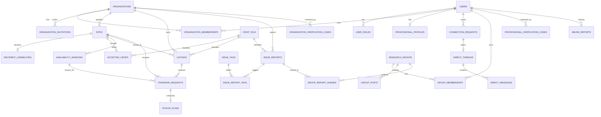

# CropCircle — Software Requirements Specification

| Field | Value |
|---|---|
| Document | SRS-001 |
| Version | 0.1, proposed design baseline |
| Date | 2026-11-21 |
| Status | Ready for product and engineering review; unresolved decisions are recorded in §14 |
| Source | Product brief supplied by the project owner |
| Companion | [Technical implementation plan](IMPLEMENTATION_PLAN.md) |

## 1. Purpose and conventions

CropCircle is a proposed web platform for moving surplus crops from farmers to eligible food banks, community organizations, farmers markets, and produce buyers, while enabling farmers and agricultural specialists to connect around crop health and collaborative research. This SRS defines observable behavior, data, interfaces, and proposed release gates. It is a specification, not evidence that an application has been built or deployed.

**Requirement status:** `BR` means directly requested in the product brief. `P` means a proposed implementation requirement or target that needs owner approval. `D` means an unresolved product decision. `MVP` means needed for the first usable release; `Later` means a later release. Terms such as *must* in a `P` row define the proposed acceptance baseline, not a decision already made by the owner. All dates and times exchanged by APIs use ISO 8601 with an offset or UTC; user interfaces use the site's configured time zone. Precise farm and issue locations are private data.

## 2. Product goals, scope, and assumptions

### 2.1 Goals and success measures

| ID | Goal | Proposed pilot measure (P; baseline to be set before launch) |
|---|---|---|
| G-01 | Make surplus discoverable and transferable | Completed transfers, kilograms transferred, and median time from listing to acceptance; report donations and sales separately. |
| G-02 | Find capable nearby recipients | Percentage of active listings with at least one eligible recipient and percentage of accepted requests completed. |
| G-03 | Support crop issue collaboration | Reports with a relevant peer or verified professional connection; groups with at least two active farmer members. |
| G-04 | Maintain trust and safety | Verification turnaround, moderation response time, disputed transfer rate, and privacy/security incidents. |

Metrics require consent-aware aggregation; they must not expose an individual's crop, exact location, or issue report publicly. Numeric success thresholds are open because launch geography, inventory, and staffing are unknown.

### 2.2 Release boundary

**MVP (BR/P):** Identity and scoped roles; farm and recipient profiles; manual organization and professional verification; surplus listings; PostGIS eligibility search; deterministic, explainable ranking; a donation or sale request with pickup coordination and state tracking; live scoped updates with reconnect reconciliation; crop issue reports; similar opt-in reports and verified expert directory; contact requests and basic private messaging; research groups, invitations, posts, and moderation; admin review and audit.

**Later (P):** Learned recipient reranking, semantic issue matching, image-assisted triage, route travel-time optimization, automated quality grading, multilingual localization beyond launch languages, payments, tax receipts, inventory system integrations, and advanced research analytics. FastAPI is designed and deployed only when a validated model is ready; it is not a dependency of the MVP transfer path.

**Out of MVP pending decisions (D):** In-platform payment or settlement, shipping/transport marketplace, official disease diagnosis, pesticide treatment advice, regulatory reporting on behalf of users, donation valuation, and research data licensing.

### 2.3 Working assumptions to validate

| ID | Working assumption | Consequence if changed |
|---|---|---|
| A-01 | A pilot launches in one country/region with a defined crop vocabulary. | Localization, jurisdictional rules, and cloud data residency may change. |
| A-02 | One MVP listing is offered as a whole to one recipient at a time; a declined/expired request permits another. A request's mass must equal the listing's full mass. The schema retains quantity for future split fulfillment. | Partial allocation requires revised inventory, matching, and request UX. |
| A-03 | A sale request records proposed terms and pickup; payment occurs outside CropCircle. | Checkout, tax, refund, fraud, and finance controls become new scope. |
| A-04 | Recipient staff maintain finite pickup/intake windows with declared mass capacity. A window's free capacity is declared capacity minus active/fulfilled reservations; the recipient confirms feasibility on acceptance. | Automatic integrations, capacity semantics, and stale-data policy may change under D-03. |
| A-05 | Exact pickup details become visible to the accepted recipient and participating farmer only; map markers use an intentionally coarse point. | Location policy and authorization checks need redesign. |
| A-06 | The platform presents crop issue matches as informational and does not claim to diagnose or prescribe treatment. | A regulated advisory workflow and specialist review may be required. |
| A-07 | Users can hold more than one platform role, and organizations can have multiple members. | Identity and authorization model may simplify or expand. |

## 3. Actors and authorization model

| Actor | Scope and core capabilities | Verification boundary |
|---|---|---|
| Farmer | Manages a farm membership, listings, requests, crop issue reports, connections, and groups. | Farm membership authorizes farm data; identity policy is D-02. |
| Food bank or community organization staff | Maintains recipient sites, accepted crops, capacity and schedule; responds to donations and pickup plans. | Organization must be approved before appearing as an eligible recipient. |
| Farmers market or produce buyer staff | Maintains procurement capabilities, responds to sale requests, coordinates pickup. | Organization must be approved before appearing as eligible. |
| Agricultural professional | Maintains expertise and credential evidence; responds to consented issue connections and joins groups. | A "verified professional" badge requires completed credential review. |
| Researcher | Joins or facilitates research groups; sees only material explicitly shared with the group or otherwise consented. | Institutional verification and research data rights are D-08. |
| Platform administrator | Reviews verification, moderates resources and users, manages taxonomy, and inspects audit events. | Separate privileged role, MFA, least privilege, recorded actions. |

An organization has one or more members with `owner`, `manager`, or `member` scope, joined through an owner/manager invitation. Users may request farmer, professional, or researcher roles; recipient/buyer staff scope follows accepted membership in a corresponding organization. Admin role provisioning is restricted to operations. A platform role alone never grants access to another farm's or organization's private records. Public/anonymous discovery is undecided (D-09); MVP endpoints assume authentication unless explicitly stated.

## 4. Functional requirements

Priority `M` = MVP; `L` = later. Every proposed requirement is testable against the listed behavior.

| ID | Priority | Actor | Requirement |
|---|---|---|---|
| FR-01 | M | All | Register/sign in through the selected identity provider, maintain a profile, manage session and notification preferences, and see accessible error states. |
| FR-02 | M | All | Authorization checks both platform role and ownership/membership for every private API, socket room, media URL, and state mutation. |
| FR-03 | M | Farmer | Create and manage farm organization/site records and invited farm members, including a private pickup address and a separate coarse public map point. |
| FR-04 | M | Farmer | Create, edit, withdraw, and view a listing with crop, mass and unit, harvest/availability dates, expiry, condition, handling/storage needs, offer mode, optional sale terms, and pickup site. |
| FR-05 | M | Farmer | See verified, currently eligible recipient sites in list and map views, with distance and rejection/empty-state explanation; no exact private location leaks to map users. |
| FR-06 | M | Farmer | See a stable, versioned recipient ranking with understandable reasons and manually select a recipient. No ranking automatically commits a transfer. |
| FR-07 | M | Farmer | Create and track a donation or sale request for an eligible recipient; cancel only under the defined state policy. |
| FR-08 | M | Farmer | Propose/confirm a pickup window, record handoff/receipt evidence as permitted, and dispute a transfer outcome. |
| FR-09 | M | Farmer | Report a suspected crop disease or pest concern with crop, symptoms/tags, observation date, coarse region, optional narrative/media, and visibility consent. |
| FR-10 | M | Farmer | View similar consented reports and verified professional profiles, send/receive contact requests, and exchange messages after acceptance. |
| FR-11 | M | Farmer | Create a research group, invite members, manage membership, share selected reports explicitly, and post observations. |
| FR-12 | M | Recipient staff | Submit organization verification evidence, edit approved recipient site capabilities (crop types, offer modes, handling/storage, max batch, radius), and maintain finite availability windows and declared intake capacity without overwriting reservations. |
| FR-13 | M | Recipient staff | Receive, accept, or decline requests; acceptance rechecks verification, eligibility, available quantity, and current capacity atomically. |
| FR-14 | M | Recipient staff | Coordinate pickup and confirm received quantity/condition; exceptions route to a dispute workflow rather than silently changing an accepted transfer. |
| FR-15 | M | Professional | Submit expertise and credential evidence, manage contact preference, respond to issue contact requests, and participate in permitted groups. Any change to the profile's credential-bearing expertise resets the whole profile to pending verification until reviewed again. |
| FR-16 | M | Researcher | Create/join groups where permitted; access only group-shared reports/posts, with provenance and sharing consent visible. |
| FR-17 | M | Administrator | Approve/reject organization and professional verification with reviewer, reason, timestamp, and retained evidence reference. Status changes affect eligibility/badges immediately. |
| FR-18 | M | Administrator | Review user-submitted abuse reports; hide/remove content, suspend accounts or organizations, handle disputes, and record reason and actor in an append-only audit trail. |
| FR-18a | M | All | Submit an abuse report against visible content or a user; see a confirmation without gaining access to the moderation case. |
| FR-19 | M | All | Receive durable in-app notifications; active views receive scoped real-time invalidations; after reconnect, clients refetch authoritative state. |
| FR-20 | M | System | Expire listings/requests when policy thresholds are reached, re-evaluate eligibility after capability changes, and prevent duplicate/out-of-order state transitions. |
| FR-21 | L | System | Call a private FastAPI model service to rerank eligible recipients and find similar issue reports, with model version, reasons, evaluation, timeout, and deterministic fallback. |
| FR-22 | L | System | Offer image-assisted crop issue triage only after expert validation, consent, jurisdictional review, and an abstention path. |

### 4.1 Domain rules and state machines (P)

| Resource | States and allowed path | Invariant |
|---|---|---|
| Listing | `draft -> open -> reserved -> completed`; `open -> withdrawn/expired`; `reserved -> open` only on pre-handoff cancellation; `reserved -> disputed` after a disputed handoff. | A closed, expired, suspended, or completed listing cannot receive a new request. One active request per listing in MVP; mass/site/mode cannot change while a request is pending. |
| Transfer request | `pending -> accepted -> pickup_scheduled -> picked_up -> completed`; `pending -> declined/expired/cancelled`; `accepted/pickup_scheduled -> cancelled` before handoff; `picked_up -> disputed/completed`. | Request mass equals the listing's full mass in MVP. Acceptance, listing reservation, and capacity-window reservation commit together. Same idempotency key and body replay the original response; different body conflicts. |
| Organization | `unverified -> pending_review -> approved/rejected/suspended`; an approved site can be `available/unavailable`. | Only approved, available recipient sites enter eligibility. Verification changes do not erase existing transfer records. |
| Issue report | `draft -> open -> resolved/closed/hidden`. | Visibility and consent control every search result, event, and group share. |
| Connection | `pending -> accepted/declined/cancelled`. | Direct messaging opens only after acceptance; blocked users cannot reconnect. |
| Research group membership | `invited -> active/declined/removed/left`. | Group membership and report-sharing permission are separate checks. |

All state changes use an expected aggregate version. A conflict returns current state and `409`, so clients can refresh. At acceptance the server locks the listing and chosen availability-window rows, rechecks quantity, eligibility, and a nonempty intersection of the listing availability, recipient intake window, and listing active period; it increments that window's reserved mass, sets the listing's available mass to zero, writes audit and outbox records, then commits. The final pickup interval must fit entirely within that intersection. Declared window capacity cannot be lowered below reserved mass. A pre-handoff cancellation releases its reservation; completion retains the window allocation through that window's end. Exact capacity semantics and cancellation/expiry/dispute policy remain D-03/D-04.

## 5. User stories and acceptance criteria

These Given/When/Then criteria are the minimum end-to-end scenarios for the MVP.

| ID | User story | Acceptance criteria |
|---|---|---|
| US-01 | As a farmer, I create a listing so surplus can be placed. | **Given** an authorized farm member with a site, **when** required crop, quantity, mode, condition, and time fields are valid, **then** a listing ID and `open` state are returned; invalid mass/time/crop is rejected; exact site coordinates are absent from public responses. |
| US-02 | As recipient staff, I state what my site can accept so farmers see accurate matches. | **Given** approved organization membership, **when** capabilities or a finite capacity window change, **then** the new version is stored and audited and subsequent discovery uses it; capacity cannot be lowered below reserved mass, and an unapproved site is never marked eligible. |
| US-03 | As a farmer, I see nearby capable recipients so I can choose where to offer crops. | **Given** an open listing, **when** discovery runs, **then** each eligible result satisfies mode, crop, mass, radius, capacity, timing, and handling rules and shows approximate distance; zero results explain which constraints limited matches. |
| US-04 | As a farmer, I compare ranked recipients so I can make an informed choice. | **Given** an unchanged candidate set and scoring version, **when** ranking is repeated, **then** the order and tie break are stable and each reason is displayed. The later ML fallback is verified under FR-21/M6. |
| US-05 | As a farmer, I request a donation or sale so the recipient can respond. | **Given** an eligible selected site and owner permission, **when** I confirm the full-listing request, **then** one pending request and notification are created; a repeated idempotency key with the same body returns the original status/body, while the same key with a different body or a second active request fails with `409`. |
| US-06 | As recipient staff, I accept and schedule pickup so the transfer can proceed. | **Given** a pending request tied to an intake window, **when** authorized staff accepts, **then** eligibility, full mass, free window capacity, and farmer/recipient time overlap are rechecked and request/listing/window reservation commit together; a pickup outside that overlap or stale/ineligible acceptance returns `409`; both parties see the pickup plan. |
| US-07 | As either transfer party, I know when pickup is completed. | **Given** an accepted request, **when** permitted parties record handoff and receipt, **then** the request and listing complete once, receipt quantity is retained, and a dispute branch remains available under D-04. |
| US-08 | As an active user, I see fresh listing, recipient, and map state. | **Given** a committed change, **when** the relevant room is connected, **then** it receives a scoped event within the proposed latency target; **when** it reconnects after a gap, **then** REST returns the latest version; unrelated rooms receive no private details. |
| US-09 | As a farmer, I report a crop issue so I can find help. | **Given** farmer membership, **when** I submit crop, symptoms, observed date, and visibility, **then** the report is saved and discoverable only to consented audiences; photo analysis is never represented as confirmed diagnosis. |
| US-10 | As a farmer, I contact someone with similar experience or a qualified specialist. | **Given** an opt-in related report or verified profile, **when** I request contact, **then** only the intended user is notified; they can accept/decline; messaging is private and a self-declared professional does not get a verified badge. |
| US-11 | As farmers, we form a research group so we can share observations. | **Given** a creator, **when** a group is created and another farmer accepts an invitation, **then** both can post; a private group and unshared reports are inaccessible to nonmembers; removal revokes access. |
| US-12 | As an admin, I verify an organization so recipients can be trusted. | **Given** a pending case, **when** I approve/reject with a reason, **then** reviewer/time/decision are auditable and discovery reflects approval; ordinary staff cannot perform this action. |
| US-13 | As an admin, I moderate unsafe activity so the platform remains usable. | **Given** a reported listing, issue, group, or account, **when** I apply a permitted action, **then** a reason and actor are recorded, affected content disappears from unauthorized discovery, and existing transfer history is preserved. |

## 6. End-to-end workflow contracts

### 6.1 Transfer path (A–F)

1. Farmer selects a farm site and submits the listing form. NestJS validates identity, site ownership, crop, mass, mode, availability, and condition; PostgreSQL commits the listing and an outbox event. Optional listing photos upload after the listing ID exists and become visible only after scanning.
2. Discovery calls PostGIS with the exact private pickup point; it filters approved recipient sites by service radius, declared capabilities, and free capacity in a finite intake window. The UI shows only approved coarse/aggregate map data and suitable candidate details.
3. A versioned deterministic scorer orders eligible candidates and shows reasons. A later FastAPI reranker may reorder **only** the eligible set, under a feature flag and deterministic fallback.
4. Farmer selects one recipient and an offered intake window, then confirms a full-listing request. The server rechecks eligibility, enforces A-02, records terms, and notifies the recipient. Creation does not yet reserve the crop or window capacity.
5. Authorized recipient staff accept or decline. Acceptance locks and rechecks listing and window capacity, reserves the full quantity in both, and reveals exact pickup details to the transfer parties. They agree a pickup interval contained in the intersection of farmer availability, selected recipient intake window, and listing active period, then record handoff and receipt; discrepancies follow the dispute path.
6. The outbox publisher emits scoped events after commit. Browser cards, timelines, and map data refetch as needed. Reconnected clients fetch authoritative snapshots rather than trusting missed socket events.

### 6.2 Crop issue and collaboration path (G–I)

1. Farmer submits a suspected issue with controlled crop/symptom tags, observed date, and explicit visibility/research-sharing choices. The report ID is created first; optional photos then upload against that ID and become visible after scanning. Location is generalized outside owner/admin access.
2. Search combines consented crop/tag similarity and approximate geography and lists verified professional expertise. The farmer may send a contact request; the recipient accepts or declines before private messages open.
3. A farmer creates a group, invites other farmers/professionals/researchers, and posts observations. Adding an issue report to a group requires its owner's explicit share action. Removing a member removes access on the next request and room reauthorization.

### 6.3 Admin trust path (J)

1. Organization or professional submits evidence to a private verification case.
2. Admin reviews evidence, records approval/rejection and reason, and may suspend later. The audit event, status, and outbox event commit together.
3. Eligibility/search and badges reflect the committed status. Existing requests are retained and flagged for manual resolution if a recipient is suspended. Moderation changes are likewise audited.

### 6.4 A–J traceability by layer

`R` = read; `I` = insert; `U` = update. Every listed write also inserts `audit_events` (where security/business relevant) and `outbox_events` in the same transaction. Events are server-to-client invalidations or safe summaries; the REST API is authoritative.

| Workflow | Frontend components | NestJS modules / FastAPI use | Database operations | Real-time events |
|---|---|---|---|---|
| **A. Create listing** | Farm selector, listing form, crop selector, mass/unit control, time picker, private location selector, confirmation | AuthZ, Farms, Listings, Media, Outbox | R `organization_memberships`, `sites`, `crop_taxa`; I `listings`, optional `media_assets` | `listing.created` to owner; `map.features_changed` to coarse region |
| **B. Find nearby organizations** | Recipient map/list, capability filters, reason/empty state | GeoSearch, Organizations, Eligibility | R `listings`, `sites`, `recipient_capabilities`, `accepted_crops`, `availability_windows`, `organizations`; PostGIS indexed radius query and free-window-capacity calculation | `organization.availability_changed` and `map.features_changed` trigger refetch |
| **C. Rank recipients** | Ranked cards, reason chips, score version/info | Recommendations; optional private FastAPI reranker **Later** | R eligible set; I `recommendation_runs` and `recommendation_candidates` if audit/persistence enabled | `recommendation.ready` only for asynchronous recomputation |
| **D. Create donation/sale request** | Recipient detail/window selector, terms review, request confirmation/timeline | Requests, Listings, Eligibility, Notifications | R/recheck listing, site, and intake window; I `transfer_requests`, `notifications`; enforce full-mass and active-request constraints | `request.created` to parties; `listing.updated` to owner |
| **E. Accept and coordinate pickup** | Recipient inbox, shared request timeline, pickup scheduler, receipt/dispute controls | Requests, Capacity, Pickup, Notifications | U `transfer_requests`, `listings`, `availability_windows`; I/U `pickup_plans`; I `notifications` | `request.accepted/declined`, `pickup.updated/completed`, `listing.updated`, `organization.availability_changed`, `map.features_changed` |
| **F. Refresh listing, recipient, map** | Listing cards, recipient cards, map layer, notification center, reconnect handler | Outbox worker, Redis emitter, Socket gateway, GeoSearch cache, REST snapshots | R committed source rows/outbox; U outbox publish state; invalidate cached projections | `listing.updated`, `organization.availability_changed`, `map.features_changed` after accept/cancel/receipt/expiry |
| **G. Report disease/pest concern** | Issue form, symptom/crop tags, optional upload, visibility consent, issue detail | Issues, Taxonomy, Media, Consent | I `issue_reports`, `issue_report_tags`, optional `media_assets`; R farm membership | `issue.created` only to authorized audience |
| **H. Connect similar people** | Related reports, peer/professional cards, contact request, private thread | IssueMatching, Professionals, Connections, Messaging; optional FastAPI similarity **Later** | R permitted `issue_reports`, tags, `professional_profiles`; I/U `connection_requests`; I `direct_threads`, `direct_messages` | `issue.match_found` if async, `connection.requested/accepted`, `message.created` |
| **I. Form research group** | Group form, invites, member roster, post feed, report-share control | Groups, Membership, Posts, Consent, Notifications | I/U `research_groups`, `group_memberships`, `group_invitations`, `group_posts`, `group_report_shares` | `group.created`, `group.invitation.created`, `group.member_joined`, `group.post_created` |
| **J. Verify/manage** | Admin verification queue, evidence viewer, abuse-report queue, moderation console, audit viewer | Admin, Verification, Moderation, Audit | R `abuse_reports`, scanned evidence; U `organizations`, `professional_profiles`, verification cases, moderated targets; I `moderation_actions`, `audit_events` | `organization.verification_changed`, `professional.verification_changed`, `moderation.action_applied`, `map.features_changed` |

## 7. Non-functional requirements and proposed pilot gates

The numeric gates below are **proposals**, not confirmed customer SLAs. Benchmark load and data volume are D-11. Pre-release load, failover, and restore gates are measured in staging; monthly availability is monitored after production launch.

| ID | Category | Proposed measurable requirement / verification |
|---|---|---|
| NFR-01 | Availability | Proposed 99.5% monthly web/API SLO during pilot, with observation window and exclusions set at D-11. Before launch, demonstrate health checks, multi-zone failover/soak, rollback, and incident runbook; production monitoring measures the monthly SLO. |
| NFR-02 | API performance | Under agreed pilot load, p95 authenticated read latency below 500 ms and p95 state-changing requests below 1 s at the API boundary, excluding media upload and external notifications. Collect per-route histograms. |
| NFR-03 | Real time | p95 from committed change to a connected authorized UI receiving an invalidation below 2 s. After disconnect, the client refetches current state on reconnect or detected version gap. |
| NFR-04 | Scalability | Stateless web/API/socket instances scale horizontally; PostGIS GiST indexes, cursor pagination, bounded bounding boxes, Redis fanout, and queued slow tasks. Capacity is proven against D-11 load, not asserted from architecture alone. |
| NFR-05 | Integrity | No duplicate accepted transfer or over-reservation under concurrent requests; idempotency keys, version checks, row locks, transactional outbox, and invariant tests. |
| NFR-06 | Recovery | Proposed RPO <= 15 minutes and RTO <= 4 hours; encrypted backups and a timed restore drill must demonstrate these targets. Retention is D-10. |
| NFR-07 | Security | TLS in transit; encryption at rest; least-privilege identities; admin MFA; server-side role/ownership checks; rate limits; secure cookie/session settings; CSRF/XSS/SQL injection controls; secret rotation; tested against a selected [OWASP ASVS](https://asvs.owasp.org/) profile. |
| NFR-08 | Privacy | Minimize and classify personal, exact location, photo/EXIF, credential, and research data; deny by default; separate public/coarse and private/exact geometry; explicit report sharing and ML consent; deletion/export/retention rules resolved before pilot. |
| NFR-09 | Media safety | Restrict MIME and size, verify actual file type, scan uploads, strip EXIF where appropriate, use signed time-limited URLs, and never expose raw storage keys to public clients. |
| NFR-10 | Accessibility | Target [WCAG 2.2 AA](https://www.w3.org/TR/WCAG22/) for core flows; map information has a keyboard-accessible list equivalent, clear labels/errors, focus management, and non-color status cues. |
| NFR-11 | Observability | Correlated request/trace IDs, structured redacted logs, metrics for transfer conversion, queue lag, socket connections, spatial query latency, and model fallback; alerts with named on-call owner. |
| NFR-12 | Compatibility | Responsive desktop/mobile web across the supported browser matrix defined at D-12; critical transfer flows work when live transport is unavailable through REST refresh. |
| NFR-13 | Maintainability | Versioned OpenAPI and event schemas; migration reviews; CI with unit, integration, E2E, accessibility, security, and dependency checks; environment parity via infrastructure as code. |
| NFR-14 | Data safety | Report suggestions and ranking are advisory. No automated transfer acceptance, official pest determination, or treatment instruction. Human users and verified professionals remain responsible for decisions. |

## 8. Relational data schema

### 8.1 Conventions and keys

PostgreSQL is the source of truth. Primary keys are UUIDs. All mutable business tables include `created_at timestamptz`, `updated_at timestamptz`, and `version integer` (starting at 1); event/audit rows are append-only. `numeric(12,3)` is used for canonical kilograms, while the UI may accept kilograms or pounds with explicit conversion and retained input unit/value. Price is an integer minor-currency amount with ISO 4217 currency, pending D-05. Values and statuses use constraints/enums or reference tables, not arbitrary client text. Foreign keys use restrictive deletion for transfer/audit history; data erasure is a policy decision, not a cascade. Private geometry uses `geography(Point,4326)`; public point is an intentionally generalized, stored point/area label, not a client-side rounding of exact coordinates.

| Table | Essential columns (types; `?` optional) | Keys and business constraints |
|---|---|---|
| `users` | `id uuid`, `auth_subject text`, `email citext`, `display_name text`, `account_status text`, `locale text?` | Unique auth subject and normalized email. No plaintext password. |
| `user_roles` | `user_id uuid`, `role text` | PK `(user_id, role)`; role in farmer, recipient_staff, buyer_staff, professional, researcher, admin. |
| `organizations` | `id uuid`, `type text`, `name text`, `verification_status text`, `status text` | Type in farm, food_bank, community, market, buyer, research_institution; approved status requires recorded review. |
| `organization_memberships` | `organization_id uuid`, `user_id uuid`, `member_role text`, `status text` | PK `(organization_id,user_id)`; app checks membership on all org mutations. |
| `organization_invitations` | `id uuid`, `organization_id uuid`, `invitee_email citext`, `member_role text`, `invited_by uuid`, `status text`, `expires_at timestamptz` | One active invitation per organization/email; acceptance creates a membership; owners cannot remove the last owner. |
| `sites` | `id uuid`, `organization_id uuid`, `address_private text`, `exact_geog geography(Point,4326)`, `public_geog geography(Point,4326)`, `public_area_label text`, `timezone text` | FK organization; `public_geog` is generated through approved generalization policy, not raw exact point. Unique `(id,organization_id)` supports ownership FK. |
| `crop_taxa` | `id uuid`, `canonical_name text`, `parent_id uuid?`, `active boolean` | Unique normalized name within parent; curated by admin. |
| `recipient_capabilities` | `site_id uuid`, `accepts_donation boolean`, `accepts_sale boolean`, `max_batch_kg numeric(12,3)`, `service_radius_m integer`, `pickup_supported boolean`, `cold_storage boolean`, `status text` | PK site; positive max batch and nonnegative radius. Site belongs to a non-farm approved organization to be eligible. Window-level intake capacity is separate. |
| `accepted_crops` | `site_id uuid`, `crop_taxon_id uuid` | PK `(site_id,crop_taxon_id)`; only declared crops eligible. |
| `availability_windows` | `id uuid`, `site_id uuid`, `start_at timestamptz`, `end_at timestamptz`, `declared_capacity_kg numeric(12,3)`, `reserved_kg numeric(12,3)`, `capacity_updated_at timestamptz` | `end_at > start_at`; `0 <= reserved_kg <= declared_capacity_kg`; free mass = declared minus reserved. One finite intake window is selected per request; no overlapping windows per site in MVP. Recurrence/refresh policy is D-03. |
| `listings` | `id uuid`, `farm_org_id uuid`, `site_id uuid`, `created_by uuid`, `crop_taxon_id uuid`, `lot_reference text?`, `quantity_kg numeric(12,3)`, `input_quantity numeric(12,3)`, `input_unit text`, `available_kg numeric(12,3)`, `offer_mode text`, `condition_notes text`, `handling_needs text?`, `harvested_at timestamptz?`, `available_from timestamptz`, `available_until timestamptz`, `expires_at timestamptz`, `asking_amount_minor bigint?`, `currency char(3)?`, `status text` | FK `(site_id,farm_org_id)` to site ownership; positive quantity; `available_kg` equals full quantity when open and zero when reserved/completed; valid windows; sale terms conditional. Lot/traceability policy is D-06. Farm type checked by domain service/DB constraint strategy. |
| `media_assets` | `id uuid`, `owner_user_id uuid`, `purpose text`, `listing_id uuid?`, `issue_report_id uuid?`, `transfer_request_id uuid?`, `subject_org_id uuid?`, `subject_user_id uuid?`, `object_key text`, `media_type text`, `scan_status text`, `exif_removed boolean` | Exactly one parent/subject among listing, issue, transfer, organization evidence, professional evidence. Purpose must match parent; private object key; only clean assets served. Evidence may be uploaded before a review case links it. |
| `transfer_requests` | `id uuid`, `listing_id uuid`, `recipient_site_id uuid`, `availability_window_id uuid`, `created_by uuid`, `quantity_kg numeric(12,3)`, `mode text`, `proposed_amount_minor bigint?`, `currency char(3)?`, `status text`, `accepted_by uuid?`, `accepted_at timestamptz?`, `expires_at timestamptz?` | One active request per listing in MVP via partial unique index; request quantity equals listing full quantity at creation/acceptance; chosen window belongs to recipient site and covers proposed pickup; mode matches listing. |
| `pickup_plans` | `request_id uuid`, `window_start timestamptz`, `window_end timestamptz`, `status text`, `handoff_at timestamptz?`, `received_at timestamptz?`, `received_kg numeric(12,3)?`, `condition_notes text?`, `handoff_evidence_asset_id uuid?`, `receipt_evidence_asset_id uuid?` | PK request; pickup interval lies within farmer availability, selected intake window, and listing active period; evidence FKs refer to scanned transfer media; custody/receipt fields editable only through permitted transitions. |
| `issue_reports` | `id uuid`, `farm_org_id uuid`, `site_id uuid?`, `reporter_user_id uuid`, `crop_taxon_id uuid`, `observed_at date`, `narrative text?`, `suspected_label text?`, `public_region text`, `visibility text`, `research_consent boolean`, `ml_consent boolean`, `status text` | Site FK must belong to farm; `visibility` controls search, group share, and events; suspected label never means confirmed diagnosis. |
| `issue_tags` | `id uuid`, `tag_type text`, `name text`, `active boolean` | Controlled symptom/pest/disease vocabulary; unique `(tag_type,name)`. |
| `issue_report_tags` | `issue_report_id uuid`, `tag_id uuid` | PK pair. |
| `professional_profiles` | `user_id uuid`, `expertise text`, `region text?`, `credential_summary text?`, `verification_status text`, `contact_opt_in boolean` | PK user; whole-profile public badge only if approved. Any credential-bearing expertise edit resets status to pending; evidence stored privately through a new verification case. |
| `connection_requests` | `id uuid`, `requester_user_id uuid`, `target_user_id uuid`, `issue_report_id uuid?`, `status text`, `message_intro text?` | No self-request; target opt-in and report visibility checked; duplicate pending pair guarded. |
| `user_blocks` | `blocker_user_id uuid`, `blocked_user_id uuid`, `created_at timestamptz` | PK pair; no self-block. Blocks prevent new contacts and future direct messages between the pair. |
| `direct_threads` / `direct_thread_members` | `direct_threads.id uuid`, `connection_request_id uuid`; member `(thread_id,user_id)` | Unique connection request FK; thread created only for accepted connection; exactly authorized members see it. |
| `direct_messages` | `id uuid`, `thread_id uuid`, `author_user_id uuid`, `body text`, `sent_at timestamptz` | Author must be an active thread member; retention policy D-10. |
| `research_groups` | `id uuid`, `created_by uuid`, `title text`, `topic text`, `visibility text`, `status text` | Visibility in private/discoverable; group ownership policy D-08. |
| `group_invitations` | `id uuid`, `group_id uuid`, `invitee_user_id uuid`, `invited_by uuid`, `status text`, `expires_at timestamptz?` | Unique active invite per group/invitee. |
| `group_memberships` | `group_id uuid`, `user_id uuid`, `group_role text`, `status text` | PK pair; group role owner/moderator/member. |
| `group_posts` | `id uuid`, `group_id uuid`, `author_user_id uuid`, `body text`, `status text` | Author must be active member; hidden posts remain auditable. |
| `group_report_shares` | `group_id uuid`, `issue_report_id uuid`, `shared_by uuid`, `consent_at timestamptz`, `revoked_at timestamptz?` | PK `(group_id,issue_report_id)`; report owner permission required; revocation immediately affects reads. |
| `notifications` | `id uuid`, `user_id uuid`, `type text`, `resource_id uuid`, `read_at timestamptz?`, `created_at timestamptz` | Durable in-app notification; payload contains safe summary only. |
| `organization_verification_cases` | `id uuid`, `organization_id uuid`, `evidence_asset_id uuid`, `status text`, `reviewer_user_id uuid?`, `decision_reason text?`, `decided_at timestamptz?` | FK to scanned `media_assets` with matching `subject_org_id`; case history retained; reviewer cannot approve own organization (P). |
| `professional_verification_cases` | `id uuid`, `professional_user_id uuid`, `evidence_asset_id uuid`, `status text`, `reviewer_user_id uuid?`, `decision_reason text?`, `decided_at timestamptz?` | FK to scanned `media_assets` with matching `subject_user_id`; case history retained; badge derived from approved current case. |
| `abuse_reports` | `id uuid`, `reporter_user_id uuid`, `target_type text`, `target_id uuid`, `reason_code text`, `detail text?`, `status text`, `reviewed_by uuid?` | Private moderation intake; target validated by type; rate limited, no public case access. |
| `moderation_actions` | `id uuid`, `admin_user_id uuid`, `target_type text`, `target_id uuid`, `action text`, `reason text`, `created_at timestamptz` | Append-only; target resolved and validated by type. |
| `audit_events` | `id uuid`, `actor_user_id uuid?`, `action text`, `target_type text`, `target_id uuid`, `safe_before jsonb?`, `safe_after jsonb?`, `occurred_at timestamptz` | Append-only; redact exact address, credentials, message text, tokens. |
| `outbox_events` | `id uuid`, `event_type text`, `aggregate_type text`, `aggregate_id uuid`, `aggregate_version integer`, `safe_payload jsonb`, `created_at timestamptz`, `published_at timestamptz?`, `attempts integer` | Written in same transaction as change; retryable publisher; dedupe by event ID. |
| `idempotency_records` | `actor_user_id uuid`, `method text`, `path text`, `key text`, `request_hash text`, `response_status integer`, `response_body jsonb`, `expires_at timestamptz` | Unique `(actor_user_id,method,path,key)`; hash includes canonical method/path/body; same key/hash replays original status/body only after current authorization succeeds, different hash returns `409`. TTL policy is D-04. |
| `recommendation_runs` / `recommendation_candidates` | Run: listing, method/version, input snapshot time; candidate: run/site/score/reasons | Optional MVP persistence for audit; model features and consent rules apply Later. |

**Indexes:** GiST on `sites.exact_geog` and `sites.public_geog`; B-tree on listing `(status,crop_taxon_id,available_until)`, requests `(recipient_site_id,status)` and `(listing_id,status)`, capabilities `(status)`, availability `(site_id,start_at,end_at,capacity_updated_at)`, issue `(crop_taxon_id,status,observed_at)`; GIN on approved full-text issue search if enabled; partial unique index for active MVP request; outbox `(published_at,created_at)`; memberships by user. Query plans and index selectivity are verified against pilot data. Exact-location columns never appear in broad list projections.

### 8.2 Entity relationship diagram

The diagram shows principal business relationships; `media_assets`, notifications, audit, outbox, and idempotency rows are specified in the table above. `organizations.type = farm` is required for listing and issue ownership, and `recipient_site_id` must belong to an eligible non-farm organization; these cross-table invariants need domain validation plus migration-level checks/triggers where practical.

## 9. REST API contract (NestJS)

Base path `/api/v1`; JSON over HTTPS except OIDC redirects and signed media transfer. NestJS owns all public business mutations. A selected OIDC provider supplies authentication; the application validates its session/token and maps it to `users`. Every list is cursor paginated with a bounded `limit` (proposed maximum 100), explicit filters, stable ordering, and a documented response projection. `Idempotency-Key` is required for request creation, acceptance, pickup completion, invitations, and admin decisions. Keys are scoped to actor, method, and path; the hash covers canonical method/path/body. Same key and body replay the stored original status/body **only after current authorization is rechecked**; same key with different body returns `409`; a new key that violates a domain constraint also returns `409`. Mutations use `If-Match`/resource `version` to reject stale state. Success responses include resource `id`, `status`, `version`, `updatedAt` where relevant. Errors use `{code, message, details?, requestId}` with `400` malformed request, `401` no session, `403` insufficient scope, `404` absent or intentionally hidden resource, `409` state/version/capacity conflict, `422` domain validation, `429` rate limit, `5xx` server failure. Exact schemas become OpenAPI artifacts in M1–M4.

Legend: `F` farmer on own farm, `O` authorized recipient staff, `P` professional, `R` group-authorized researcher, `A` admin, `U` authenticated user. Public read scope is D-09. The table names the essential request and response fields; all IDs are UUIDs.

| ID | Method and path | Actor; key input | Success; key output | Main checks/errors |
|---|---|---|---|---|
| API-01 | `POST /auth/registrations` | New user; identity assertion/profile | `201` user ID/session context | Provider verification; duplicate email `409`. Provider flow D-02. |
| API-02 | `GET /me` | U | `200` profile, roles, memberships, preferences | `401` invalid session. |
| API-03 | `PATCH /me` | U; display name/preferences | `200` updated profile | Validated fields, version. |
| API-04 | `POST /organizations` | U; type/name | `201` organization ID, unverified | Permitted type, create owner membership. |
| API-05 | `GET /organizations/{id}` | U; ID | `200` safe profile/capabilities | Private evidence/contact filtered by scope. |
| API-06 | `PATCH /organizations/{id}` | Owner/manager; profile | `200` organization/version | Membership and status. |
| API-07 | `POST /organizations/{id}/sites` | Owner/manager; address, exact point, time zone, public area | `201` site ID | Point bounds; coarse point policy; ownership. |
| API-08 | `PUT /sites/{id}/capabilities` | O; modes, max batch, radius, storage, crops, status | `200` capability/version | Approved org for eligibility; positive max batch; audit and map invalidation. |
| API-09 | `PUT /sites/{id}/availability-windows` | O; finite windows with declared intake mass | `200` window IDs/free mass/version | Reject overlaps and reductions below reserved mass; time zone and freshness policy D-03. |
| API-10 | `POST /organizations/{id}/verification-cases` | Owner/manager; evidence asset ID | `201` pending case ID | Evidence private/scanned; duplicate pending case `409`. |
| API-11 | `POST /listings` | F; farm/site, crop, lot reference if applicable, quantity/unit, mode, dates, condition, handling, optional sale terms | `201` listing ID/status/version | Site ownership, valid quantity/window, traceability/sale policies D-05/D-06. |
| API-12 | `GET /listings` | U; bbox/crop/mode/cursor | `200` page of safe listing summaries | Bbox/limit bounds; no exact pickup coordinates. |
| API-13 | `GET /listings/{id}` | U; ID | `200` role-filtered listing | Exact details only to authorized parties. |
| API-14 | `PATCH /listings/{id}` | F; editable fields/version | `200` listing/version | Mass/site/mode cannot change while an active request exists; `409` stale state. |
| API-15 | `POST /listings/{id}/withdraw` | F; reason/version | `200` withdrawn listing | No active accepted handoff. |
| API-16 | `GET /listings/{id}/eligible-recipients` | F; radius/cursor/filters | `200` candidates with site ID, eligible intake window ID/free mass, approved coarse location, distance, eligibility reasons | Owner check; verified/fresh window capacity; bounded radius. |
| API-17 | `GET /listings/{id}/recommendations` | F; optional run/version | `200` ranked eligible site IDs, reason codes, score, method/version | No ineligible candidates; deterministic fallback. |
| API-18 | `POST /listings/{id}/transfer-requests` | F; recipient site ID, intake window ID, full-listing quantity, mode, terms, idempotency key | `201` pending request ID/version | Quantity must equal listing mass; chosen intake window must overlap farmer availability/active period; pickup time is agreed later; same key/body replays `201`; new active request or same key/different body returns `409`. |
| API-19 | `GET /transfer-requests/{id}` | Transfer party/A | `200` request, terms, pickup state | Party membership; role-filter exact location. |
| API-20 | `GET /organizations/{id}/transfer-requests` | O; status/cursor | `200` inbox page | Organization membership. |
| API-21 | `POST /transfer-requests/{id}/accept` | O; version, idempotency key | `200` accepted request/listing/window versions | Transactional recheck/lock listing and chosen intake window; `409` if no longer eligible/free. |
| API-22 | `POST /transfer-requests/{id}/decline` | O; reason/version | `200` declined request | Pending only. |
| API-23 | `POST /transfer-requests/{id}/cancel` | Transfer party; reason/version | `200` cancelled or `202` dispute review | State/policy D-04. |
| API-24 | `PUT /transfer-requests/{id}/pickup-plan` | Transfer party; start/end within farmer/recipient availability and listing active period, notes, version | `200` pickup plan/version | Accepted state, time intersection, party authorization; moving intake windows is D-04. |
| API-25 | `POST /transfer-requests/{id}/handoff` | Farmer/recipient per D-04; time/scanned transfer evidence asset ID | `200` picked-up state | Idempotent transition, dispute if mismatch. |
| API-26 | `POST /transfer-requests/{id}/receipt` | O; received mass/condition/scanned transfer evidence asset ID, idempotency key | `200` completed or disputed state | Cannot exceed offered mass; policy D-04. |
| API-27 | `GET /map/features` | U; bbox/zoom/filters/cursor | `200` coarse feature collection, result version | Bounds/limit, no private point; list equivalent. |
| API-28 | `POST /issue-reports` | F; farm, crop, symptoms, date, region/visibility/consent | `201` report ID/version | Membership and explicit consent; optional photos upload afterward through API-48. |
| API-29 | `GET /issue-reports/{id}` | Owner/authorized viewer | `200` visibility-filtered report | Hidden/private `404` to nonviewer. |
| API-30 | `PATCH /issue-reports/{id}` | Reporter/F; status, consent, tags | `200` report/version | Revocation immediately affects search/group access. |
| API-31 | `GET /issue-reports/{id}/similar` | Owner/authorized viewer; cursor | `200` consented report/professional summaries with reason/method | Crop/tag/region criteria; no private geometry. |
| API-32 | `GET /professionals` | U; crop/tag/region/cursor | `200` opt-in profiles and verified status | No unapproved verified badge. |
| API-33 | `POST /professionals/me/verification-cases` | P; credential evidence asset ID | `201` pending case | Asset belongs to professional and is scanned/private. |
| API-34 | `POST /connection-requests` | U; target user, originating report, intro | `201` pending connection ID | Consent/visibility/blocks/rate limit. |
| API-35 | `POST /connection-requests/{id}/accept` or `/decline` | Target U; version | `200` state; thread ID if accepted | Intended recipient only, idempotent. |
| API-36 | `GET /direct-threads/{id}/messages` and `POST /direct-threads/{id}/messages` | Thread member; cursor or body | `200` page / `201` message ID | Active membership, content limits, moderation reporting. |
| API-37 | `POST /research-groups` | F/R/P; title/topic/visibility | `201` group ID, creator membership | Role and title validation. |
| API-38 | `GET /research-groups/{id}` | U with visibility | `200` group/role-safe metadata | Private group denied to outsiders. |
| API-39 | `POST /research-groups/{id}/invitations` | Group owner/moderator; invitee | `201` invitation ID | Duplicate and abuse limits. |
| API-40 | `POST /group-invitations/{id}/respond` | Invitee; accept/decline | `200` membership/invitation state | Intended invitee only. |
| API-41 | `GET /research-groups/{id}/posts` and `POST /research-groups/{id}/posts` | Active member; cursor or body | `200` page / `201` post ID | Membership, content limits. |
| API-42 | `POST /research-groups/{id}/report-shares` and `DELETE /research-groups/{id}/report-shares/{reportId}` | Report owner; report ID | `201` share / `204` revoked | Explicit share consent; revocation rechecks reads. |
| API-43 | `GET /notifications` and `POST /notifications/{id}/read` | U; cursor or ID | `200` page/read state | Only owner. |
| API-44 | `GET /admin/organization-verification-cases` and `GET /admin/professional-verification-cases` | A; status/cursor | `200` private review queue | MFA and admin scope. |
| API-45 | `POST /admin/organization-verification-cases/{id}/decide` and `/professional-verification-cases/{id}/decide` | A; approve/reject, reason, version | `200` decision/status | Self-review forbidden; audit; eligibility invalidation. |
| API-46 | `POST /admin/moderation-actions` | A; target/action/reason | `201` action ID/status | Valid target/action, audit, preserve history. |
| API-47 | `GET /admin/audit-events` | A with audit permission; filters/cursor | `200` redacted audit page | Least privilege; export policy D-10. |
| API-48 | `POST /media/upload-intents` and `POST /media/{id}/finalize` | Authorized uploader; purpose, one existing parent/subject, type, size/checksum | `201` short-lived upload URL / `200` scan pending or ready | Listing/issue created first; parent/subject ownership, MIME/size/scan/auth; unfinalized uploads expire and are purged; no public raw keys. |
| API-49 | `GET /auth/start`, `GET /auth/callback`, `POST /auth/logout` | New/U; OIDC redirect/state or active session | `302` provider/app redirect or `204` logout | State/nonce/PKCE and CSRF/session handling selected at D-02; provider owns credential entry. |
| API-50 | `GET /professionals/me` and `PATCH /professionals/me` | P; expertise, region, contact opt-in | `200` profile/version | Owner only; a credential-bearing expertise edit resets whole-profile verification to pending until a new case is approved under D-02. |
| API-51 | `GET /connection-requests` | U; inbox/outbox, cursor | `200` scoped request page | Only requester or target. |
| API-52 | `GET /direct-threads` | U; cursor | `200` authorized thread page | Active member only; blocked pair filtered. |
| API-53 | `POST /users/{id}/block` and `DELETE /users/{id}/block` | U; target ID | `201` blocked / `204` unblocked | No self-block; contact/message policy enforced immediately. |
| API-54 | `GET /research-groups` and `GET /research-groups/{id}/members` | U; mine/discoverable, cursor | `200` safe group/member page | Private group membership required. |
| API-55 | `GET /group-invitations` and `DELETE /research-groups/{id}/members/{userId}` | Invitee or group member/owner/moderator; cursor/member ID | `200` invite page / `204` left or removed | Member may remove self; moderators remove others; protect last owner and revoke room immediately. |
| API-56 | `GET /admin/organization-verification-cases/{id}` and `GET /admin/professional-verification-cases/{id}` | A; case ID | `200` case detail and short-lived evidence read URL | MFA, audit evidence access, no raw object key. |
| API-57 | `GET /crop-taxa` and `GET /issue-tags` | U; search/cursor | `200` active taxonomy page | Stable IDs; inactive terms excluded from new forms. |
| API-58 | `POST /admin/crop-taxa`, `PATCH /admin/crop-taxa/{id}`, `POST /admin/issue-tags`, `PATCH /admin/issue-tags/{id}` | A; term/parent/status/version | `201/200` taxonomy term | Audit changes and preserve historical references. |
| API-59 | `POST /abuse-reports` and `GET /admin/abuse-reports` | U; visible target/reason, or A; status/cursor | `201` private report ID / `200` review queue | Target visibility and rate limit; admin MFA; reporter cannot read case details. |
| API-60 | `POST /me/roles` | U; farmer/professional/researcher role selection | `200` active role | Admin role cannot self-assign; professional badge still needs case review; recipient staff derives from accepted organization membership. |
| API-61 | `POST /organizations/{id}/invitations`, `GET /organization-invitations`, `POST /organization-invitations/{id}/respond` | Owner/manager or intended invitee; email/role/accept/decline | `201` invite / `200` inbox or membership | Invite permission, expiry, duplicate handling, matching identity. |
| API-62 | `GET /organizations/{id}/members`, `PATCH /organizations/{id}/members/{userId}`, `DELETE /organizations/{id}/members/{userId}` | Owner/manager or self for leave; scoped role/status | `200` members/updated / `204` removed | Cannot remove last owner; revocation immediately ends private room/API access. |
| API-63 | `GET /sites/{id}` and `PATCH /sites/{id}` | Authorized organization member; address, exact point, public area, time zone/version | `200` role-filtered site/version | Private address only to staff/accepted transfer parties; audit and map invalidation. |
| API-64 | `GET /me/transfer-requests` and `GET /me/issue-reports` | F; status/cursor | `200` owner-scoped history pages | Membership and reporter scope; no cross-farm leak. |

`GET /health/live` and `GET /health/ready` are restricted operational endpoints. Search and map endpoints may use HTTP caching only when the cache key includes authorization scope and safe projection; private responses default to no shared caching.

## 10. WebSocket contract (Socket.IO gateway)

Connect to `/realtime` using the existing authenticated session and server-side origin/CSRF policy. The server authorizes each room join and reauthorizes membership on relevant status changes. Client commands are limited to `subscribe`/`unsubscribe` for `user`, `organization`, `listing`, `request`, `group`, or bounded `map-region` scopes; all business mutations use REST. A subscription acknowledgement gives room, current resource version or snapshot URL, and any denial code. Never trust a client-supplied room ID alone.

Every server event carries `{eventId, schemaVersion, aggregateType, aggregateId, aggregateVersion, occurredAt, data}`. `data` contains safe IDs, status, and coarse summary only; clients fetch role-filtered resource detail by REST. `eventId` deduplicates; `aggregateVersion` detects gaps. No email, token, exact pickup point, credential, report photo, or private message body enters a map-region event. For `map.features_changed`, `aggregateType=map_region`, `aggregateId` is an opaque authorized coarse-region ID, `aggregateVersion` is that region's query version, and `occurredAt` is a coalesced batch timestamp rather than the underlying listing/site commit time. Region invalidations are emitted only where the changed feature is visible to that room's audience; they contain no listing/site ID. Sparse-area re-identification policy is D-07. Socket.IO default delivery is at most once; the Redis adapter does not provide connection-state recovery, so reconnection always triggers a REST snapshot/cursor reconciliation ([delivery guarantees](https://socket.io/docs/v4/delivery-guarantees/), [Redis adapter](https://socket.io/docs/v4/redis-adapter/)).

| Event | Trigger | Authorized room; safe `data` |
|---|---|---|
| `listing.created` / `listing.updated` | Listing commit/status change | Owner farm and permitted watchers; listing ID, status, version. |
| `organization.availability_changed` | Capability, window capacity/reservation, or suspension change | Organization members and authorized listing viewers; site ID, availability/version. Coarse map room gets separate safe invalidation. |
| `map.features_changed` | Listing/recipient eligibility or public feature change | Authorized bounded coarse region; opaque region ID, region query version, and batch time only, coalesced/suppressed according to D-07; refetch map. |
| `recommendation.ready` | Async ranking job finishes | Listing owner; listing ID, run ID/method/version; refetch. |
| `request.created` | Farmer submits request | Farmer and recipient organization; request ID, status, version. |
| `request.accepted` / `request.declined` / `request.cancelled` | Request transition | Transfer parties; request ID/status/version. |
| `pickup.updated` / `pickup.completed` | Schedule, handoff, or receipt commit | Transfer parties; request ID, pickup status/version. |
| `issue.created` / `issue.match_found` | Consented report or async match | Reporter and explicitly authorized audience; report ID and safe summary only. |
| `connection.requested` / `connection.accepted` | Contact transition | Requester/target user rooms; connection ID/status. |
| `message.created` | Authorized direct message | Thread members; thread/message ID and version, then REST fetch body. |
| `group.created` / `group.member_joined` | Group/membership commit | Group members/invitee as relevant; group ID/status/member ID. |
| `group.invitation.created` / `group.post_created` | Invite/post commit | Invitee or active group room; IDs and version, then REST fetch. |
| `organization.verification_changed` / `professional.verification_changed` | Admin decision | Subject owner/members; subject ID/status/version. Map invalidated separately. |
| `moderation.action_applied` | Admin decision | Affected owner and authorized moderators; target ID/action/status, without private evidence. |

The outbox worker retries safe publication through a private Socket.IO Redis emitter (or an API-side consumer selected in an ADR); API gateway replicas then use the Redis adapter to fan out. PostgreSQL remains the durable event/state source, and duplicate publishes are deduplicated by event ID. If long polling is enabled across replicas, load balancing needs sticky sessions; WebSocket-only transport avoids that particular requirement ([Socket.IO Redis adapter](https://socket.io/docs/v4/redis-adapter/)). Fallback REST polling is required when WebSockets fail.

## 11. AI, geospatial, and deployment requirements

### 11.1 Matching and AI boundary

**MVP candidate eligibility:** approved and available recipient site; matching donation/sale mode; crop accepted; full listing mass no larger than max batch and free mass in a selected finite intake window; pickup/handling/storage compatible; listing availability overlaps that intake window; exact private sites satisfy the service radius. Capacity freshness threshold is D-03. These are hard gates, never overridden by ML. Within the eligible set, a deterministic score may use distance, window overlap, and declared capacity margin with a documented weight/version and stable tie break. Weights are a pilot tuning decision, not a hidden business rule. Each result provides reason codes and a freshness timestamp. Acceptance rechecks all mutable gates.

**Later FastAPI:** NestJS calls a private, versioned Pydantic API for `recommendations/score` and `issues/similar`; only minimum permitted features are sent. Inference has timeout, circuit breaker, model registry/version, explanations, drift and fairness checks, feedback, and deterministic fallback. Offline training uses consented, de-identified outcomes; model promotion requires evaluation across region, farm size, crop, and recipient type. Issue similarity may retrieve similar reports and verified specialists; image triage must abstain when uncertain and must not claim an official diagnosis. See the [NIST AI Risk Management Framework](https://airc.nist.gov/airmf-resources/airmf/5-sec-core/) for risk-management practices.

### 11.2 Map and location boundary

Exact site coordinates are stored as private WGS84 geography. Server-side `ST_DWithin(geography, geography, meters)` uses a GiST index for radius eligibility; straight-line distance is a candidate filter, not a promise of drive time ([PostGIS reference](https://postgis.net/docs/ST_DWithin.html)). Public features use a reviewed coarse area policy; in sparse areas they may be aggregated or suppressed to limit re-identification from crop/date/marker combinations. Viewport queries require bounded `bbox`, zoom, filter, page size, and server-side clustering or tiling at scale; response geometry is always scope-filtered. The map has an equivalent list. Audience, granularity, and sparse-area thresholds are D-07; a routing/geocoding/map tile provider and its licensing are D-13.

### 11.3 Cloud and operational boundary

Use separate stateless Next.js, NestJS API/Socket.IO, outbox/notification worker, and optional private FastAPI containers. Place PostgreSQL/PostGIS and Redis in private networks; managed object storage holds media/evidence; CDN/WAF/TLS ingress fronts public services. Multi-zone database, backups, secrets manager, metrics/traces/logs, migration jobs, CI/CD promotion, and rollback are release requirements. A provider-neutral architecture and an illustrative AWS mapping appear in the [implementation plan](IMPLEMENTATION_PLAN.md). Cloud provider, region, budget, and residency remain D-11/D-13.

## 12. Food, plant-health, and research safeguards

Capture crop identity, mass, harvest/availability windows, condition, storage/handling needs, pickup/receipt records, responsible parties, and a lot/batch reference where required by the pilot policy. Scoped scanned media may be linked as handoff or receipt evidence. Recipient staff confirm their actual capacity and handling ability; a match is not a food-safety certification. Applicable food donation, produce safety, traceability, sale, and tax obligations depend on jurisdiction, role, and commodity, so legal/operations review is D-01/D-06 before the M2 schema is frozen. For a U.S. pilot, the [FDA produce safety](https://www.fda.gov/food/food-safety-modernization-act-fsma/fsma-final-rule-produce-safety) and [food traceability](https://www.fda.gov/food/food-safety-modernization-act-fsma/fsma-final-rule-requirements-additional-traceability-records-certain-foods) materials inform that review; they do not establish that every CropCircle transfer is covered.

Issue reports use "suspected" language. Verified specialists may advise within their own professional scope, while the platform does not provide a confirmed diagnosis or treatment instruction. Suspected regulated pests may require a jurisdiction-specific reporting route; in a U.S. pilot, link users to [APHIS plant-health contacts](https://www.aphis.usda.gov/contact/plant-health) rather than reporting on their behalf. Research groups need explicit data-sharing consent, provenance, and revocation. Intellectual property, institutional review, export, and publication rules are D-08.

## 13. Verification and release evidence required

| Gate | Evidence required before an MVP deployment claim |
|---|---|
| Requirements | Owner signs off D-01 through D-13 or records accepted limitations; every `FR` maps to a test or documented deferral. |
| Domain tests | Unit/state-machine tests for listing/request transitions, capacity and unit conversion, eligibility/ranking determinism, consent and authorization. |
| Integration tests | Real PostgreSQL/PostGIS radius, edge cases, index plan; concurrent acceptance/idempotency/outbox; upload scanning; Redis fanout. |
| End-to-end tests | Automated A–J happy paths plus denied-role, stale-state, empty-result, dispute, consent-revocation, and reconnect paths. |
| Non-functional tests | Agreed load benchmark, socket latency, accessibility audit, threat review/ASVS checks, backup restore against RPO/RTO, failover and rollback rehearsal. |
| Operations | Staging parity, migration/rollback plan, monitoring alerts, runbooks, on-call owner, incident process, data retention and deletion process. |

This document can be checked for completeness and internal consistency now; runtime, load, security, and deployability tests require an implemented system and an agreed pilot environment. The companion plan assigns these gates to milestones.

## 14. Decision register and dependencies

The owner of each decision is proposed; no answer is assumed. “Block” names the latest milestone that needs the answer before exit.

| ID | Unresolved decision | Proposed owner | Block |
|---|---|---|---|
| D-01 | Pilot country/region and applicable food donation, sale, produce-safety, traceability, privacy, and plant-health review | Product + legal/operations | M0 |
| D-02 | Identity provider, account proofing, farm ownership proof, organization/professional verification evidence and expiry | Product + trust/safety | M1 |
| D-03 | Accepted units, quantity conversion, declared capacity meaning and time-window length, capacity freshness/refresh, recurrence, recipient eligibility rules | Product + agricultural operations | M2 |
| D-04 | Partial vs whole transfers; one vs multiple pending requests; idempotency TTL, expiry/cancellation, intake-window rebooking, handoff evidence, dispute and reservation release rules; transport responsibility | Product + operations | M2/M3 |
| D-05 | Sale price negotiation, payment/settlement, invoicing, refunds, tax handling, and donation valuation/receipts | Product + legal/finance | M2 |
| D-06 | Crop condition/quality declarations, lot/batch and recall traceability fields, cold chain, custody/evidence and rejection policy, food-safety review | Agricultural operations + legal | M2/M3 |
| D-07 | Exact location/contact visibility timing; map/list audience, coarse granularity and sparse-area re-identification policy; issue-report public/private default, consent and regulated-pest escalation | Product + privacy + agronomy | M1/M4 |
| D-08 | Research group ownership, invitations, moderation, IP, research consent, publication, institutional review, and exports | Product + research/legal | M4 |
| D-09 | Anonymous/public discovery versus authenticated-only; notification channels and opt-in/urgency | Product | M1/M3 |
| D-10 | Data retention, deletion/export, backup retention, legal holds, audit and message retention | Privacy/legal + security | M0/M5 |
| D-11 | Pilot users, listings, request rate, concurrent sockets, availability/SLOs, RPO/RTO, cost ceiling and data residency | Product + engineering + operations | M0/M5 |
| D-12 | Launch languages, supported browsers/devices, accessibility acceptance process | Product + design | M1/M5 |
| D-13 | Cloud, geocoding, map/tile and optional routing providers, licensing, geographic coverage | Engineering + procurement | M0/M2 |
| D-14 | ML training consent, vendors/data use, label quality, evaluation thresholds, and human review | Product + privacy + agronomy + ML | Later |

## 15. Primary references

Design choices above are informed by official documentation: [Next.js Server and Client Components](https://nextjs.org/docs/app/getting-started/server-and-client-components), [NestJS queues](https://docs.nestjs.com/techniques/queues), [PostGIS `ST_DWithin`](https://postgis.net/docs/ST_DWithin.html), [Socket.IO delivery guarantees](https://socket.io/docs/v4/delivery-guarantees/), [Socket.IO Redis adapter](https://socket.io/docs/v4/redis-adapter/), [FastAPI request bodies](https://fastapi.tiangolo.com/tutorial/body/), [WCAG 2.2](https://www.w3.org/TR/WCAG22/), [OWASP ASVS](https://asvs.owasp.org/), and the linked FDA/APHIS/NIST materials. Version compatibility, cloud extension support, and local legal applicability must be rechecked at implementation time.
