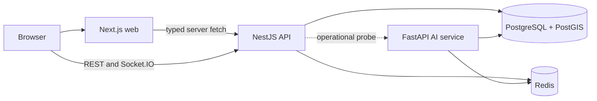

# Stage 2 architecture

The NestJS API owns future business writes. PostgreSQL is canonical storage; PostGIS will store exact site geography privately. Redis is the low-latency Socket.IO fanout dependency. The Python service is private and currently exposes health probes only; later model endpoints require the evaluation and policy gates described in the [implementation plan](../IMPLEMENTATION_PLAN.md). No browser should call it directly.

The root Compose file starts the data services first, applies Prisma migrations, then starts the API and web app. API readiness requires PostgreSQL, PostGIS and Redis. The optional AI probe is reported but does not block the API's HTTP readiness when future MVP features do not use inference. Web liveness is independent of API availability; `/api/dependencies` checks the API from the server.

The shared TypeScript package contains operational health shapes and a versioned realtime event envelope. The API client accepts a versioned API base URL and is used in the web app's server-side dependency check. Python keeps its own Pydantic definitions; its health response follows the same wire shape.

This baseline deliberately excludes domain endpoints, auth, storage, jobs and model inference until the product decisions in the SRS are resolved.
