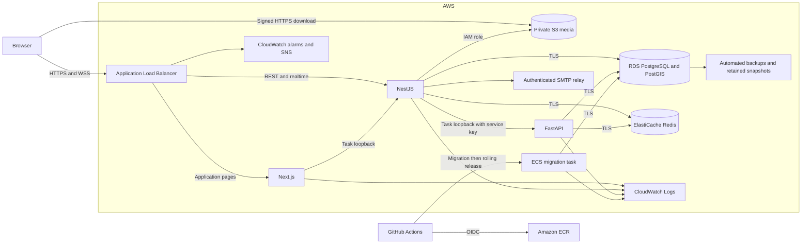

# Deploy CropCircle

## Architecture



The web, API and ML containers share a Fargate task and its loopback network. The load balancer forwards `/api/v1/*` and `/realtime/*` to NestJS. FastAPI listens on loopback. The browser downloads media using short-lived URLs signed by the task role. Production uses two tasks, Multi-AZ RDS and two Redis nodes.

## Local development

Use `docker compose up --build -d --wait`. Compose starts a disposable local PostGIS database, Redis, object storage and Mailpit. The migration container must exit successfully before either backend starts. Set a generated `ML_SERVICE_KEY` when testing private service authentication. Open [the local app](http://localhost:3000).

## Staging and production setup

1. Use a separate stack, GitHub environment, credentials, DNS hostname and storage for each environment. Supply two public and two private subnets across availability zones. Private tasks need outbound access to regional AWS endpoints and the SMTP relay.
2. Request an ACM certificate matching the public hostname in the same AWS Region. Create a Secrets Manager JSON secret containing `redis_token` using at least 32 randomly generated hexadecimal characters. Retain its ARN for the stack.
3. Deploy the foundation from an authorized AWS CLI session.

   ```sh
   aws cloudformation deploy \
     --template-file infra/aws/foundation.yaml \
     --stack-name "$CROPCIRCLE_STACK" \
     --capabilities CAPABILITY_IAM \
     --parameter-overrides Environment="$CROPCIRCLE_ENVIRONMENT" Vpc="$CROPCIRCLE_VPC" \
     PublicSubnets="$CROPCIRCLE_PUBLIC_SUBNETS" PrivateSubnets="$CROPCIRCLE_PRIVATE_SUBNETS" \
     Domain="$CROPCIRCLE_DOMAIN" CertificateArn="$CROPCIRCLE_ACM_ARN" \
     ApplicationSecretArn="$CROPCIRCLE_SECRET_ARN" AlertEmail="$CROPCIRCLE_ALERT_EMAIL"
   ```

4. Point DNS to the `EdgeDns` output and confirm the SNS subscription. Set RDS URL fields against `DatabaseHost` and a `rediss:` URL against `RedisHost` using the existing Redis token. Populate the rest of the same JSON secret using the environment reference. Bootstrap database roles from a private VPC connection. The migration role must own the app schema and be allowed to install PostGIS on the first run, or an RDS administrator must preinstall PostGIS. Grant the API role access to application tables and sequences and grant the ML role read access to feature tables and read/write access to the job table. Grant privileges for future migrations via default privileges for the migration role. Use the generated RDS administrator credentials for bootstrap.
5. Configure GitHub's AWS identity provider and a deployment role restricted to the repository and the target GitHub environment. Permit CloudFormation stack reads, ECR image publication, ECS task registration and service deployment, and `iam:PassRole` for the stack's two task roles. Ensure the ECS service-linked role exists before the first release. Restrict production deploys to the release branch and configure required reviewers. Set the environment variables listed in the reference.
6. Run **Deploy CropCircle** for staging. It runs the test workflow, pushes uniquely tagged images, checks the one-off Prisma task exit code, updates ECS and verifies public HTTPS readiness. Verify login, WebSocket and inference with staging-only users before invoking the same workflow for production.

## Monitoring, rollback and recovery

- ECS writes web, API, ML and migration streams to the foundation's CloudWatch log group. ALB errors and missing API targets alert through SNS. Inspect the failing ECS revision, container health and PostgreSQL logs when the service does not stabilize.
- Keep the prior task definition and corresponding ECR images available. ECS can roll back an unhealthy rolling deployment. The release script also restores the previous revision when its smoke checks fail. An operator can use `aws ecs update-service --cluster "$CLUSTER" --service "$SERVICE" --task-definition "$PRIOR_TASK"`, wait for stable service and recheck HTTPS.
- Keep schema migrations compatible with both running revisions. For a faulty migration, stop further releases and use a forward repair or restore to a fresh database. An ECS rollback retains applied database migrations.
- RDS keeps automated snapshots and point-in-time recovery for 14 days in production and 3 days in staging. For recovery, restore to a new private instance, verify PostGIS, row counts and migrations from a private task, and change the deployed database URLs during cutover. Restore deleted files from S3 object versions. Redis holds ephemeral presence and rate-limit state plus a delivery queue. PostgreSQL retains sessions and events awaiting delivery. Plan to rejoin sessions and replay pending work after replacing the cache.
- This configuration describes single-region recovery. Measure RPO and RTO in a staging restore drill. The app's public map providers have independent service limits.

[Amazon ECS ALB target configuration](https://docs.aws.amazon.com/AWSCloudFormation/latest/TemplateReference/aws-properties-ecs-service-loadbalancer.html) · [ElastiCache TLS](https://docs.aws.amazon.com/AmazonElastiCache/latest/dg/in-transit-encryption.html) · [RDS PostgreSQL versions](https://docs.aws.amazon.com/AmazonRDS/latest/PostgreSQLReleaseNotes/postgresql-versions.html)
